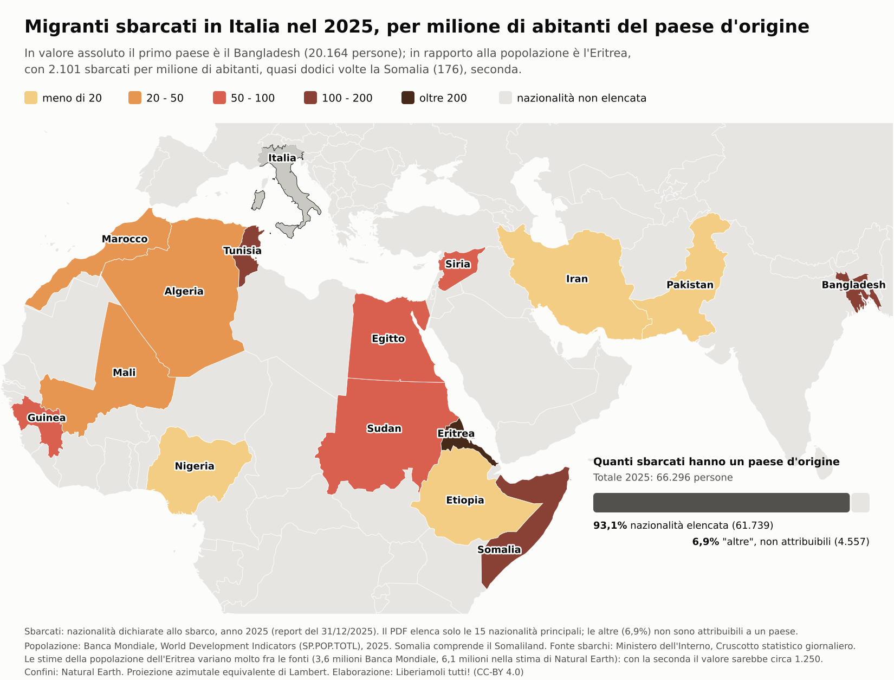

# Mappa: sbarcati 2025 per milione di abitanti del paese d'origine



Migranti sbarcati in Italia nel 2025 per nazionalità dichiarata, divisi per la popolazione del paese d'origine.

## Come si rifà

```bash
./mappa.sh
```

Richiede `mapshaper` (0.7.75 o successivo, per le palette di Crameri), `opensdmx`, `duckdb`, `python3`, `rsvg-convert`. Per un'altra palette: `./mappa.sh devon "colors=devon stops=15,85 invert"`.

## Passi

- `popolazione.yaml`: query opensdmx alla Banca Mondiale, World Development Indicators, serie `SP_POP_TOTL`, anno 2025, per i 15 paesi elencati nel report.
- `tasso.sql`: unisce popolazione e sbarcati del report del 31/12/2025 (`../../dati/nazionalita.csv`) e calcola il valore per milione di abitanti; scrive `popolazione_2025.csv` e `tasso_2025.csv`. La tabella dei codici ISO a 2 e 3 lettere è scritta a mano: una nazionalità nuova va aggiunta qui e in `popolazione.yaml`.
- `mappa.sh`: confini Natural Earth 1:50 milioni (scaricati se mancano), Somaliland unito alla Somalia, proiezione azimutale equivalente di Lambert, classi a soglie fisse 20, 50, 100, 200 con la palette `lajolla` di Fabio Crameri (`stops=15,85 invert`).
- `componi.py`: titolo, legenda con i colori effettivi di mapshaper, riquadro con la quota di sbarcati di nazionalità non attribuita, note.

## Cautele

- Il report elenca solo le 15 nazionalità principali: il 6,9% degli sbarcati è in "altre" e non è sulla mappa. I paesi grigi non hanno dato, non zero.
- La popolazione dell'Eritrea varia molto fra le fonti: 3,6 milioni per la Banca Mondiale, 6,1 milioni nella stima di Natural Earth. Con la seconda il valore sarebbe circa 1.250 per milione invece di 2.101.
